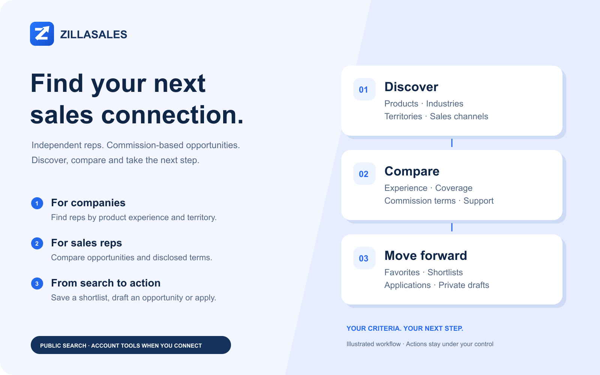

# ZillaSales: Sales Reps & Opportunities

For Cursor and Grok Bot.


Find independent sales reps and commission-based opportunities. Compare the fit, build a shortlist and take the next step with your assistant.



## What you can do

| Your goal | What you can do |
| --- | --- |
| Find independent reps | Search by product experience, industry, territory, buyer type and sales channel. |
| Find opportunities | Discover commission-based sales opportunities and compare disclosed terms, coverage and support. |
| Compare your options | Explore interactive comparison views where supported, with text results also available. |
| Build a shortlist | Connect to save selected reps or opportunities and revisit your favorites. |
| Apply with confidence | Prepare an application, review exactly what will be shared, confirm submission and track your applications. |
| Build sales coverage | Create and edit private opportunity drafts, confirm submission for review, and review your company’s applicants. |

## Try asking

- “Find independent reps for commercial LED lighting in Texas and compare their relevant experience.”
- “Find commission-based industrial automation opportunities covering Texas. Compare territory, commission terms and support.”
- “Save these opportunities to my favorites.”
- “Help me draft an opportunity for our new product line. Ask me for the missing details.”

This package can prompt for an account connection when enabled. Public service endpoints also support anonymous discovery; connected workflows use your existing permissions.

You review and confirm applications and moderation submissions before they are sent. Saving does not contact anyone, unlock contact details or spend credits. The visual illustrates the workflow, not live profiles or an in-app screenshot.

## Install and connect

This repository is a standalone Cursor plugin package. Marketplace availability depends on review; publication of the repository is not approval.

For local testing in Cursor, copy this repository's contents (including `.cursor-plugin`) into `~/.cursor/plugins/local/zillasales`, then restart Cursor. Open **Customize** and verify that the skills and MCP server appear. Local imports must be allowed by your organization. See [Cursor's plugin documentation](https://cursor.com/docs/plugins).

This package configures OAuth explicitly. Cursor may request an account connection when the plugin is enabled, including before public searches. Sign in on ZillaSales, review the permissions and approve only the intended account. Account connection is required for the package's private workflows.

Grok Bot uses the same plugin ecosystem. Once available, install through its plugin interface; see [Grok Bot setup](https://cursor.com/docs/grok-bot/get-started) for account/client requirements.

The package's MCP configuration is:

```json
{
  "mcpServers": {
    "zillasales": {
      "url": "https://zillasales.com/api/mcp/claude",
      "auth": {
        "CLIENT_ID": "cmva7m0ke16y0ql01vjrf61c5",
        "scopes": [
          "account:read",
          "favorites:read",
          "favorites:write",
          "opportunities:read",
          "opportunities:write",
          "applications:read",
          "applications:write"
        ]
      }
    }
  }
}
```

The client ID identifies this public OAuth application; it is not a password or secret. No client secret, token, authorization header or user credential is bundled. The registered callbacks are Cursor's HTTPS callback and local callback paths; S256 PKCE is mandatory. The host stores each user's tokens after consent and refreshes them normally. Disconnect through the host's connector controls; reconnect when consent expires or is revoked.

The `/claude` suffix is the existing OAuth-compatible endpoint, not a client restriction. The original OpenAI/Muse and Claude packages are unchanged. Explicit [static OAuth configuration](https://cursor.com/docs/mcp) avoids a Cursor 3.24.18 behavior in which reconnecting an anonymous server can report success without obtaining an account token.

### Anonymous access

The service still supports public tools without sign-in. To use only public features in a custom MCP client, configure `https://zillasales.com/api/mcp/claude` as a URL-only server without this package's `auth` object. Do not enable that manual server alongside the full plugin. In Cursor 3.24.18, that anonymous configuration works for public calls but does not reliably upgrade to account access; use this full package for private workflows.

## Reviewer test plan

See [TESTING.md](TESTING.md) for public smoke tests, optional account workflows, expected results and safety boundaries. Test both local component discovery and real tool calls in each target host before attesting that the plugin works in-app. Protocol tests alone do not establish host compatibility.

## Data and privacy

The skills invoke only the declared ZillaSales MCP server. The package runs no local scripts, hooks, installers or background processes. The hosted service receives tool arguments and, after OAuth consent, the account permissions needed for the requested action. It does not require the full conversation. Searches and profile/application content are processed by ZillaSales. Account records remain subject to the service retention and deletion policy. See the [privacy policy](https://zillasales.com/privacy#connected-assistants), [terms](https://zillasales.com/terms) and [developer documentation](https://zillasales.com/developers) for details.

## Pricing and scope

This MIT-licensed plugin is distributed free of charge. Public service endpoints require no account; this Cursor package may prompt for OAuth when enabled. Private workflows require an appropriate account and remain subject to its permissions and service limits. The plugin cannot purchase subscriptions, reports, contact unlocks or credits. The host application may require its own subscription. Website services and their terms are separate from this package.

## Support

Use [ZillaSales support](https://zillasales.com/developers#support). If a tool reports a rate limit, wait for its retry interval; do not invent missing results. Report reproducible plugin issues in this repository without including credentials or private records.

## License

The plugin files are MIT licensed. No hosted application code, database contents, third-party binaries or datasets are distributed here. Hosted services and their data remain subject to their own terms.
